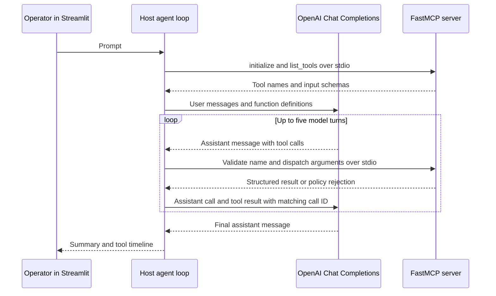

# MCP Agent Tools

A Streamlit operations console for looking up synthetic orders and inventory,
checking current weather, and calculating insurance. The host discovers and
calls an official Python SDK FastMCP server over **stdio**.

## Run locally

Install [uv](https://docs.astral.sh/uv/getting-started/installation/), then open
a terminal in this folder.

```bash
uv python install 3.11
uv sync --locked
uv run python -m streamlit run src/app.py
```

Open the local URL printed by Streamlit (normally http://localhost:8501).
**Scripted Seattle demo** uses a fixed sequence for the documented order and
still tries to fetch current weather. It needs no model key. The **OpenAI**
mode accepts free-form requests and uses the model to choose tool calls.

To enable OpenAI mode, copy `.env.example` to `.env` locally, add your
`OPENAI_API_KEY`, and leave `OPENAI_MODEL=gpt-4o-mini` or set a supported
Chat Completions model available to your account. On PowerShell use
`Copy-Item .env.example .env`. Keep the key out of Git and off camera.

## Container option

Install Docker with Compose. From the project directory:

```bash
docker compose up --build
```

Open http://localhost:8501. Streamlit launches the FastMCP child in the same
container. Compose binds the port to loopback, runs as a non-root UID on a
read-only root filesystem, drops capabilities, and limits resources. This
configuration is for a local demonstration. It shares a container between host
and server and has no per-user authentication or tenant isolation.

## Request and response flow



| File | Responsibility |
| --- | --- |
| `src/server/mcp_server.py` | FastMCP tool schemas and structured responses |
| `src/server/tools/` | Validation and bounded tool execution |
| `src/client/mcp_client.py` | Child-process lifecycle, discovery, dispatch and timeouts |
| `src/client/agent_loop.py` | Chat Completions schema mapping, message history and call IDs |
| `src/app.py` | Operator chat, runtime tool catalog, timeline and security workbench |
| `data/enterprise_ops.db` | 36 synthetic records across customers, orders and inventory |

## Tool boundaries

| Tool | Input and output | Enforcement |
| --- | --- | --- |
| `query_database` | A single SQLite SELECT. Returns columns, up to 50 rows and a truncation flag. | SQLGlot checks the statement tree and table allowlist. SQLite opens with `mode=ro` and `query_only`; the authorizer denies operations other than approved reads and functions. SQLite also limits length, expression depth, and execution time. |
| `get_current_weather` | City and optional ISO country code. Returns current modeled conditions, precipitation, temperature, wind and UTC timestamp. | Fixed HTTPS endpoints, normalized parameters, no redirects, bounded response size, rate-limit feedback and validation of returned measurements. Conditions inform dispatch review; the integration has no alert feed. |
| `calculate_expression` | Decimal numbers, parentheses and arithmetic. Returns the result as a decimal string. | Python AST node and operator allowlists, decimal arithmetic, bounded literal lengths, depth via node count, powers and magnitude. No general-purpose evaluator. |

The model receives tool schemas and result data. It does not get database
connections or choose network targets. The host verifies the tool name,
checks the argument envelope, caps output and iteration counts, and passes
typed arguments through MCP. Server validation is independent of the model.
Provider credentials are kept in the host.

## Policy checks and verified outcomes

Select **Security workbench** and run each check. The console sends the fixed
input directly through the same MCP tool boundary used by the agent.

| Input | Expected response |
| --- | --- |
| `SELECT 1; SELECT 2` | `sql_rejected` because the tool accepts a single SELECT |
| `CREATE TABLE practice (id INTEGER)` | Statement-policy rejection |
| `abs(-5)` | `math_rejected` because function calls are outside the arithmetic grammar |
| `2 ** 1000` | Magnitude-policy rejection before evaluating the power |

Automated checks cover no-op writes, unapproved reads, unauthorized functions,
and unchanged database bytes after rejections. See `tests/test_security.py`.

## Direct commands and demo prompt

```bash
uv run python -m src.server.mcp_server
uv run python -m streamlit run src/app.py
uv run python -m pytest -v
```

The standalone server waits for MCP protocol messages on standard input.
The UI starts its own server process, so a second terminal is unnecessary.

> Check whether Seattle inventory can fulfill order #4492 for SKU-90210, look up
> current Seattle weather for dispatch, and calculate shipping insurance at 3.5%.

Order #4492 needs 24 units and Seattle has 80. The order is 248,500 cents, and
the unrounded insurance result is 86.975 USD. Weather is obtained at run time
or explicitly marked unavailable. Use OpenAI mode with a configured key for the
assignment's live model demonstration. Scripted mode demonstrates the protocol
without an OpenAI request.

## Verification status

- Python 3.11.18 · 21 automated checks passed, including real SDK stdio
  discovery, a two-tool chain, and Streamlit workbench tests.
- The scripted Seattle run returned stock and insurance through MCP. The
  live weather request was unavailable in the development environment. The
  weather parser and rate-limit handling passed with mocked HTTP responses.
- OpenAI mode requires an account key. Docker packaging is included for a
  local container demo; the container runtime was unavailable during verification.

## Audit and submission

[AI prompt and verification log](ai_prompt_log.md) covers the original draft,
the MCP result schema mismatch, the SQLite authorizer behavior, and the OpenAI
final-turn response fix. [Recording and submission notes](DEMO.md) include a
timed walkthrough and LMS template.

References: [MCP Python SDK](https://github.com/modelcontextprotocol/python-sdk),
[OpenAI function calling](https://developers.openai.com/api/docs/guides/function-calling),
[Open-Meteo forecast](https://open-meteo.com/en/docs) and
[geocoding](https://open-meteo.com/en/docs/geocoding-api).
